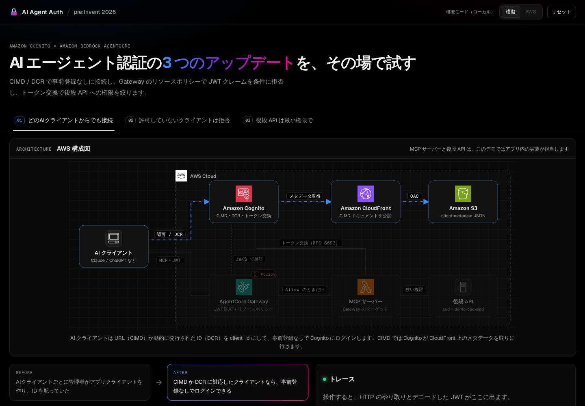
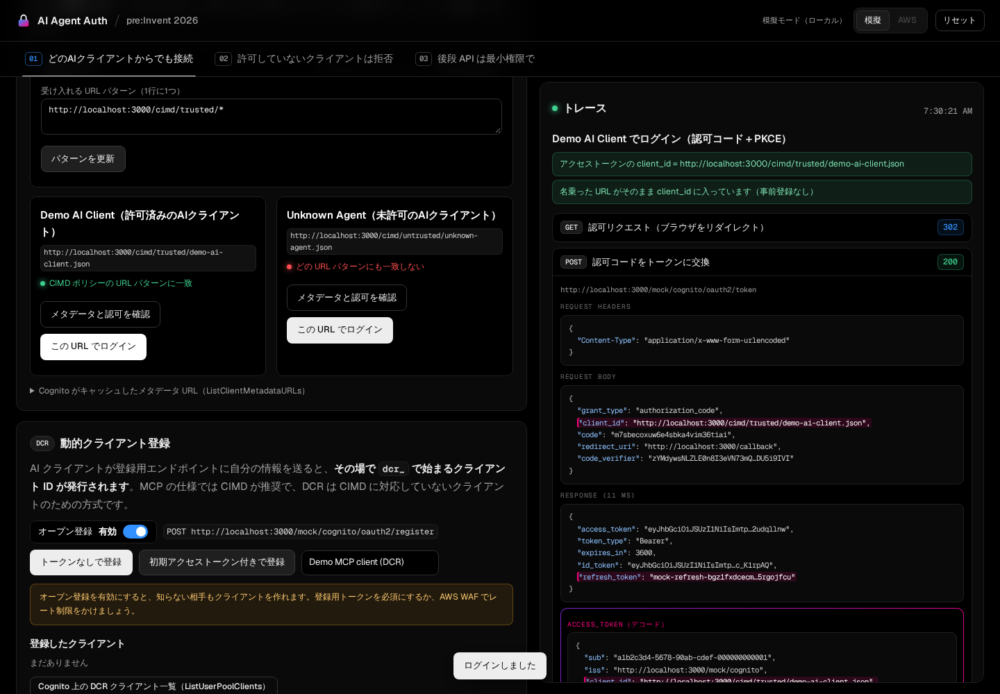
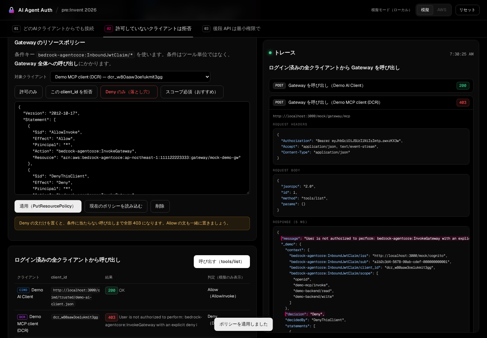
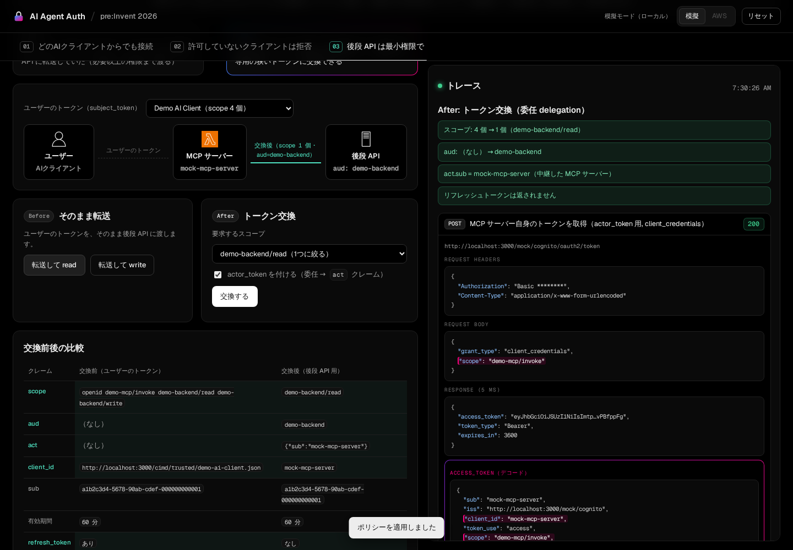
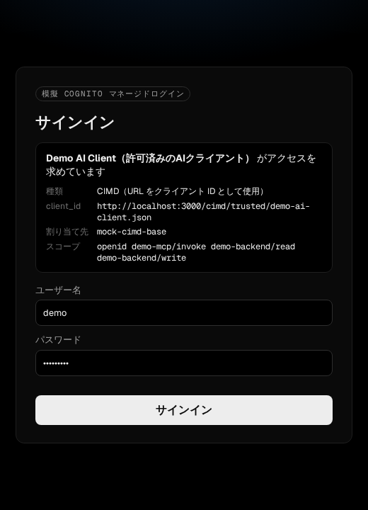

# pre:Invent 2026 AIエージェント認証デモ

[【pre:Inventまとめ】AWSのAIエージェント認証がいろいろ進化！](https://qiita.com/minorun365/items/bd6091f2599a0f37326b) の3つのアップデートを、1つの画面（3タブ）で順にデモするアプリです。

**ブラウザだけで試す: https://daisuke-awaji.github.io/preinvent-auth-demo/** （GitHub Pages。バックエンドはブラウザ内の模擬実装）



| タブ | アップデート | 見せること |
|---|---|---|
| 01 どのAIクライアントからでも接続 | Cognito **CIMD** / **DCR** | URL をクライアント ID として名乗ってログイン（`client_id` に URL が入る）、未許可の URL は拒否。DCR で `dcr_` クライアントが発行され、オープン登録を切ると 401 |
| 02 許可していないクライアントは拒否 | AgentCore Gateway の `bedrock-agentcore:InboundJwtClaim/*` 条件キー | 特定 `client_id` だけ 403。**Deny だけ置くと全部 403** の落とし穴。スコープ必須のおすすめ形 |
| 03 後段APIは最小権限で | Cognito **トークン交換（RFC 8693）** | 転送（Before）と交換（After）の比較。スコープ 4→1、`aud`、`act`、リフレッシュトークンなし、スコープ拡大は 400 |

画面上部の AWS 構成図は、選んだタブに関係する経路を色付きで示し、操作するとその呼び出しが通った経路が光ります（Gateway や後段 API で 403 になると赤く表示）。右側の「トレース」には、HTTP のやり取りとデコードした JWT（`client_id` / `scope` / `aud` / `act` を強調）が出ます。ローカル版では、トークン本体はサーバー側に置き、ブラウザにはデコード結果だけを返します。

## 使い方

```bash
npm install
npm start            # http://localhost:3000
npm test             # 模擬モードの全フローとポリシー評価のテスト
```

### GitHub Pages 版（ブラウザ内の模擬バックエンド）

`main` に push すると GitHub Actions（`.github/workflows/pages.yml`）がテストとビルドを行い、GitHub Pages に公開します。

- `npm run build:pages` で `dist/` を作ります。サーバー側のコード（`src/routes.js`・`src/mock/*`・`src/backend.js`）を esbuild でそのままブラウザ向けにまとめ、`express` と `node:crypto` などは `src/browser/` の小さな代替実装に差し替えます。
- ページ内の `fetch` は、`api/`・`mock/`・`backend/`・`cimd/`・`callback` へのリクエストをブラウザ内の模擬バックエンドで処理します。
- ログインのポップアップ（画面遷移やフォーム送信）は Service Worker（`sw.js`）が受け取り、開いているデモのページに転送して処理します。状態はデモのページのメモリにあり、再読み込みすると初期化されます。
- 鍵・トークンはブラウザ内で作る模擬のものです。AWS モードはローカル版だけです。

```bash
npm run build:pages
npm run preview:pages   # http://localhost:4000/preinvent-auth-demo/（Pages と同じサブパスで配信）
```

### 2つのモード（ローカル版）

画面右上で切り替えます。

- **模擬**（既定）: Cognito（認可・トークン・登録エンドポイント、CIMD ポリシー、DCR 設定）と Gateway（JWT 検証＋リソースポリシー評価）をローカルで模擬します。AWS もネットワークも不要なので、本番デモの予備にもなります。ログイン画面には `demo / Passw0rd!` が入力済みです。Gateway の判定理由（どの文で Allow / Deny になったか）は模擬モードだけで表示します。
- **AWS**: 実際の Cognito と AgentCore Gateway を呼びます。先に `npm run setup:aws` を実行してください。

### AWS モードの準備と片付け

```bash
export AWS_REGION=ap-northeast-1   # 省略時は ap-northeast-1
npm run setup:aws                  # 数分〜十数分（CloudFront の反映待ちを含む）
npm start
npm run teardown:aws               # デモ後に必ず実行
```

`setup:aws` が作るもの（すべて `preinvent-auth-demo-xxxxxx` という名前）:

| リソース | 用途 |
|---|---|
| Cognito ユーザープール（Essentials）＋ドメイン（マネージドログイン） | CIMD / DCR / トークン交換はどれも Essentials か Plus のプランで使えます |
| リソースサーバー `demo-mcp`（invoke）, `demo-backend`（read / write / admin） | MCP サーバー用・後段 API 用のスコープ |
| アプリクライアント `cimd-base` / `dcr-registrar` / `mcp-server` | CIMD ポリシーの割り当て先 / 初期アクセストークンの発行用 / トークン交換を行う中継役（`ALLOW_TOKEN_EXCHANGE_*`） |
| DCR 設定（オープン登録: 有効、認可コードのみ） | タブ①の DCR |
| CIMD ポリシー（`https://<CloudFront>/cimd/trusted/*`） | タブ①の CIMD |
| S3 ＋ CloudFront（OAC） | CIMD のメタデータドキュメントを HTTPS で公開（許可済み・未許可の2つ） |
| AgentCore Gateway（CUSTOM_JWT, allowedScopes = `demo-mcp/invoke`）＋ IAM ロール | タブ②。ターゲットは付けていないので `tools/list` は空です |
| テストユーザー `demo` | パスワードは `aws-config.json` の `user.password` |

作成した ID とクライアントシークレットは `aws-config.json`（パーミッション 600、`.gitignore` 済み）に保存します。共有しないでください。

### 注意

- AWS モードでは、オープン登録の切り替えは画面から行いません（`UpdateUserPool` は省略した設定をリセットするため）。コンソールの「MCP 認証」で切り替えてください。
- CIMD ドキュメントの `redirect_uris` は `http://localhost:3000/callback` です。ポートを変えるなら `PORT` を指定して setup からやり直してください。
- オープン登録は誰でもクライアントを作れます。デモ後は teardown するか、登録用トークンを必須にしてください。ユーザープールは DCR クライアントもまとめて削除されます。
- Gateway のリソースポリシーは、反映に数秒〜数十秒かかることがあります。
- 模擬モードの挙動はドキュメントと記事に合わせていますが、細部（エラーメッセージの文言、交換後トークンの `client_id` など）は実際の Cognito と違うことがあります。
  - トークン交換のスコープは「要求 ∩ 元のトークン ∩ アプリクライアントの許可」です。何も残らないときは `invalid_scope`（400）にしています。

## 構成

```
public/
  index.html / style.css  画面（Vercel 風のダークテーマ）
  app.js               画面の処理
  arch.js              AWS 構成図（公式アイコン、タブ連動のハイライト、トレースに合わせた発光）
  icons/aws/           AWS Architecture Icons（一部を暗い背景向けに白く着色）
src/
  server.js            Express（127.0.0.1 で待ち受け）
  routes.js            画面用 API・ログイン（認可コード＋PKCE、ポップアップ）・トークン置き場
  backend.js           後段 API（/backend/orders, JWKS で検証し、受け取ったトークンを分析）
  lib/policy-eval.js   IAM 条件の評価（StringEquals/Like, Null, ForAnyValue/ForAllValues, IfExists）
  lib/trace.js         HTTP のやり取りと JWT を記録（シークレットは伏せる）
  mock/cognito.js      模擬 Cognito（CIMD / DCR / client_credentials / token-exchange）
  mock/gateway.js      模擬 AgentCore Gateway（JWT 検証 → リソースポリシー → MCP 応答）
  providers/           mock / aws の切り替え（管理系の操作だけが違い、OAuth のやり取りは同じコード）
  browser/             GitHub Pages 用（express・crypto・Buffer の代替、ランタイム、Service Worker）
scripts/
  setup-aws.js / teardown-aws.js
  build-pages.js / preview-pages.js
```

## 画面






構成図のアイコンは [AWS Architecture Icons](https://aws.amazon.com/architecture/icons/) を使っています（[aws-icons](https://www.npmjs.com/package/aws-icons) パッケージから取得）。

## 参考

- [Amazon Cognito now supports client ID metadata documents](https://aws.amazon.com/about-aws/whats-new/2026/11/cognito-client-id-metadata-documents/)
- [Amazon Cognito now supports dynamic client registration](https://aws.amazon.com/about-aws/whats-new/2026/11/cognito-dynamic-client-registration/) / [Dynamic client registration（開発者ガイド）](https://docs.aws.amazon.com/cognito/latest/developerguide/cognito-user-pools-dynamic-client-registration.html)
- [Amazon Cognito now supports OAuth 2.0 token exchange](https://aws.amazon.com/about-aws/whats-new/2026/11/cognito-token-exchange/) / [Exchanging tokens for downstream services](https://docs.aws.amazon.com/cognito/latest/developerguide/cognito-user-pools-token-exchange.html)
- [Use IAM condition keys with Amazon Bedrock AgentCore Gateway](https://docs.aws.amazon.com/bedrock-agentcore/latest/devguide/security-gateway-condition-keys.html#gateway-invocation-condition-keys) / [Resource-based policies](https://docs.aws.amazon.com/bedrock-agentcore/latest/devguide/resource-based-policies.html)
